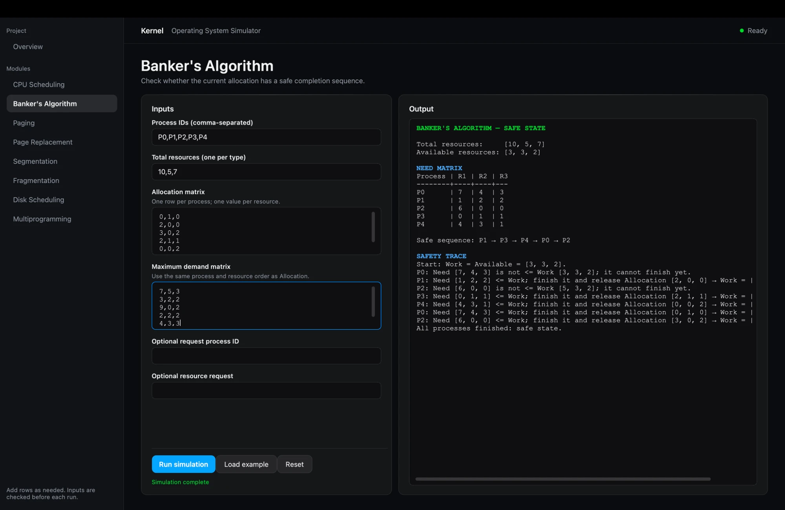
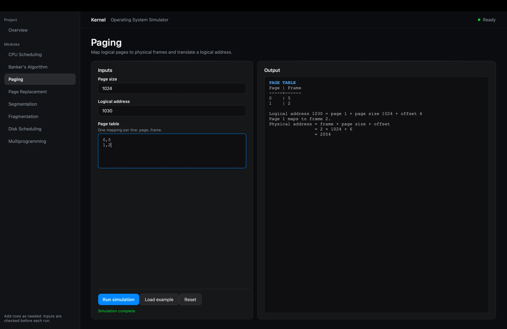
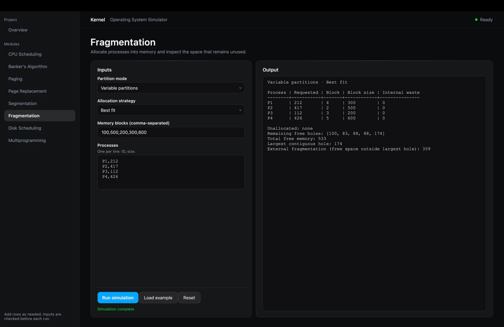
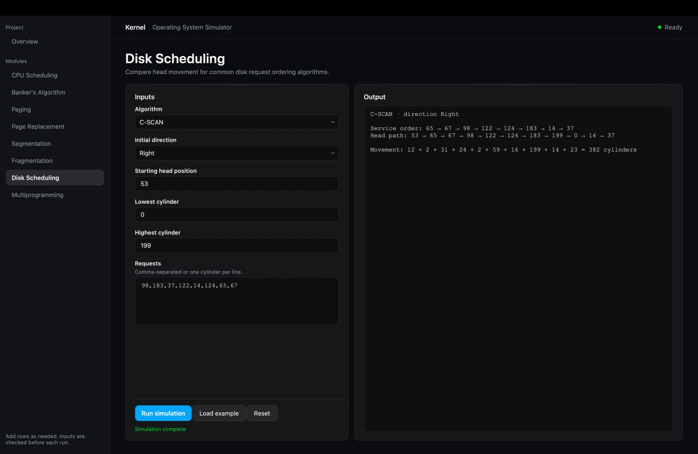

# KERNEL — Operating System Simulator

A small Python desktop app for exploring operating-system concepts. The interface uses PySide6 (Qt); the simulation modules use only the Python standard library.

## Run on Windows

1. Install Python 3.10 or newer from [python.org](https://www.python.org/downloads/). During setup, enable **Add python.exe to PATH**. The launcher installs the dependency (PySide6, listed in `requirements.txt`) automatically on first run.
2. Download this project from GitHub using **Code → Download ZIP**, then extract the ZIP. (If you already use Git, clone the repository instead.)
3. Open the extracted `kernel-os-simulator` folder.
4. Double-click `run.bat` to start the simulator.

To work on the code, install [Visual Studio Code](https://code.visualstudio.com/), open the project folder, and optionally install Microsoft's Python extension. You can also run `kernel_app.py` from VS Code.

## Modules

- CPU Scheduling: FCFS, non-preemptive SJF, preemptive SRTF, priority, and Round Robin, with response-time metrics
- Banker's Algorithm: need and available resources, safe-state check, safe sequence, and optional tentative resource requests
- Paging and Page Replacement: page mapping, address translation, FIFO, LRU, and Optimal
- Segmentation: segment-table checks and logical-address translation
- Fragmentation: First Fit, Best Fit, Next Fit, and Worst Fit
- Disk Scheduling: FCFS, SSTF, SCAN (Elevator), C-SCAN, LOOK, and C-LOOK
- Multiprogramming: time-sliced CPU sharing and memory admission

The CPU scheduling page shows a time-scaled Gantt chart with individual process blocks and boundary times in the simulation output. CPU Scheduling and Multiprogramming accept times such as `2 hr/s` or `30 min/s`; when a suffix is used, bare time values are interpreted as minutes.

## Algorithm descriptions and sample runs

Screenshots are in `docs/`. **Reset** clears every text field in the current module and **Load example** restores the sample data. Every module accepts any number of rows/items; invalid input shows an error message instead of crashing.

### 1. CPU Scheduling
**Input:** algorithm, time quantum (Round Robin), and one process per line: `ID,arrival,burst,priority`. **Process:** the ready process is chosen by arrival (FCFS), shortest burst (SJF), shortest remaining time (SRTF), lowest priority number (Priority, both modes) or by rotating time slices (Round Robin); gaps become CPU idle time. **Output:** completion, turnaround (CT-AT), waiting (TAT-BT) and response times, averages, CPU utilization and a Gantt chart.
Sample: `P1,0,5,2 / P2,1,3,1 / P3,2,8,3 / P4,3,6,2` → average waiting FCFS 5.75, SJF 5.25, SRTF 5.00, Round Robin (q=2) 9.75.

### 2. Banker's Algorithm
**Input:** process IDs, total instances per resource, Allocation and Maximum matrices, optional request. **Process:** Need = Max - Allocation; Available = Total - sum of Allocation; repeatedly finish any process whose Need <= Work and add its Allocation back to Work. A request is granted only if it is <= Need, <= Available and the resulting state is safe. **Output:** Need matrix, safe/unsafe, safe sequence and step trace.
Sample: 5 processes, total `10,5,7` (textbook example) → safe, sequence `P1 → P3 → P4 → P0 → P2`; request `P1: 1,0,2` is granted.

### 3. Paging
**Input:** page size, page table (`page,frame` per line), logical address. **Process:** page = address // size, offset = address % size, physical = frame x size + offset; unmapped page = page fault. **Output:** the calculation step by step.
Sample: size 1024, table `0,5 / 1,2`, address 1030 → page 1, offset 6, frame 2, physical 2054.

### 4. Page Replacement
**Input:** reference string, number of frames, FIFO / LRU / Optimal. **Process:** on a fault with full frames, FIFO evicts the oldest loaded page, LRU the least recently used, Optimal the page used farthest in the future. **Output:** frame contents per step, hit/fault per step, totals and fault rate.
Sample: `7,0,1,2,0,3,0,4,2,3,0,3,2,1,2,0,1,7,0,1`, 3 frames → FIFO 15, LRU 12, Optimal 9 faults.

### 5. Segmentation
**Input:** segment table (`segment,base,limit`), segment number and offset. **Process:** valid only if offset < limit; physical = base + offset. **Output:** the physical address, or an out-of-range error.
Sample: segment 1 (base 6300, limit 400), offset 99 → 6399; offset 400 → error.

### 6. Fragmentation
**Input:** memory block sizes, processes (`ID,size`), fixed or variable partitions, First/Best/Next/Worst fit. **Process:** each process takes the block chosen by the strategy; fixed partitions waste the rest of the block (internal), variable partitions split it and leave holes (external). **Output:** allocation table, unallocated processes, internal waste or free holes and external fragmentation.
Sample: blocks `100,500,200,300,600`, processes `212,417,112,426` → First fit leaves P4 unallocated, Best fit places all four.

### 7. Disk Scheduling
**Input:** request list, head position, cylinder range, direction. **Process:** FCFS in arrival order; SSTF nearest next; SCAN (Elevator) sweeps to the disk end then reverses; C-SCAN sweeps then jumps to the other end; LOOK/C-LOOK turn at the last request. **Output:** service order, head path and total movement.
Sample: `98,183,37,122,14,124,65,67`, head 53, 0-199 → FCFS 640, SSTF 236, SCAN 331, C-SCAN 382, LOOK 299, C-LOOK 322.

### 8. Multiprogramming
**Input:** memory capacity, time slice, programs (`ID,arrival,burst,memory`). **Process:** a program is admitted when enough memory is free, admitted programs share the CPU round-robin, memory is released on completion. **Output:** final status, CPU timeline, peak memory, CPU utilization, throughput and context switches.
Sample: memory 100, programs `A,0,4,60 / B,0,2,60 / C,1,3,30` → B waits for memory until A finishes.

## Testing

`python -m unittest discover tests` runs 30 tests: known textbook answers, boundary and error cases, and one large dataset per module (hundreds to 20,000 items). Output is saved in `docs/test-results.txt`.

## Project team

- Amiel Amido — Group leader
- Kevin James Riparip — Project team
- Rafael Carlos III — Project team

## Project files

`kernel_app.py` starts the application. The `kernel_sim` folder contains the interface and the individual simulation modules. `run.bat` is a Windows launcher, and `.vscode/launch.json` provides a VS Code debug configuration.

## Notes

This is an educational simulator. It demonstrates simplified models and does not control the computer's actual CPU, memory, or disks.
