# KERNEL — Operating System Simulator

A small Python desktop app for exploring operating-system concepts. The interface uses PySide6 (Qt); the simulation modules use only the Python standard library.

## Run on Windows

1. Install Python 3.10 or newer from [python.org](https://www.python.org/downloads/). During setup, enable **Add python.exe to PATH**. The launcher installs the dependency (PySide6, listed in `requirements.txt`) automatically on first run.
2. Download this project from GitHub using **Code → Download ZIP**, then extract the ZIP. (If you already use Git, clone the repository instead.)
3. Open the extracted `kernel-os-simulator` folder.
4. Double-click `run.bat` to start the simulator.

To work on the code, install [Visual Studio Code](https://code.visualstudio.com/), open the project folder, and optionally install Microsoft's Python extension. You can also run `kernel_app.py` from VS Code.

## Modules

- CPU Scheduling: FCFS, non-preemptive SJF, preemptive SRTF, priority, and Round Robin, with response-time metrics
- Banker's Algorithm: need and available resources, safe-state check, safe sequence, and optional tentative resource requests
- Paging and Page Replacement: page mapping, address translation, FIFO, LRU, Optimal, Second Chance, Clock, NRU, NFU, Random, and Working Set
- Segmentation: segment-table checks and logical-address translation
- Fragmentation: First Fit, Best Fit, Next Fit, and Worst Fit (one process per block)
- Disk Scheduling: FCFS, SSTF, SCAN (Elevator), C-SCAN, LOOK, and C-LOOK
- Multiprogramming: equal-share CPU sharing among active jobs

The CPU scheduling page shows a time-scaled Gantt chart with individual process blocks and boundary times in the simulation output. CPU Scheduling and Multiprogramming accept decimal times such as `0.5` and suffixed times such as `2 hr/s` or `30 min/s`; when a suffix is used, bare time values are interpreted as minutes.

## Algorithm descriptions and sample runs

Screenshots are in `docs/`. **Reset** clears every text field in the current module and **Load example** restores the sample data. Every module accepts any number of rows/items; invalid input shows an error message instead of crashing.

### 1. CPU Scheduling
**Input:** algorithm, time quantum (Round Robin), and one process per line: `ID,arrival,burst,priority`. **Process:** the ready process is chosen by arrival (FCFS), shortest burst (SJF), shortest remaining time (SRTF), highest priority number (Priority, both modes) or by rotating time slices (Round Robin); gaps become CPU idle time. **Output:** completion, turnaround (CT-AT), waiting (TAT-BT) and response times, averages, CPU utilization and a Gantt chart.
Sample: `P1,0,5,2 / P2,1,3,1 / P3,2,8,3 / P4,3,6,2` → average waiting FCFS 5.75, SJF 5.25, SRTF 5.00, Round Robin (q=2) 9.75.
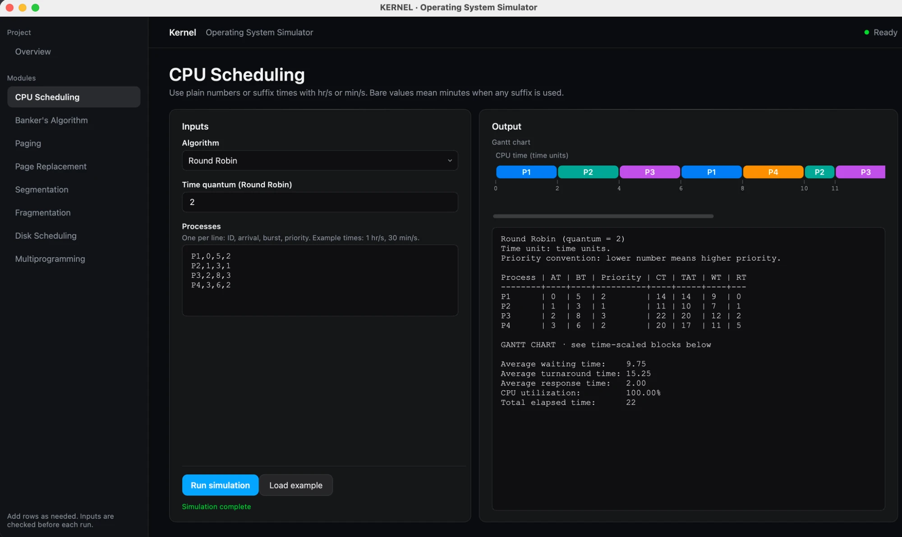

### 2. Banker's Algorithm
**Input:** process IDs, total instances per resource, Allocation and Maximum matrices, optional request. **Process:** Need = Max - Allocation; Available = Total - sum of Allocation; repeatedly finish any process whose Need <= Work and add its Allocation back to Work. A request is granted only if it is <= Need, <= Available and the resulting state is safe. **Output:** Need matrix, safe/unsafe, safe sequence and step trace.
Sample: 5 processes, total `10,5,7` (textbook example) → safe, sequence `P1 → P3 → P4 → P0 → P2`; request `P1: 1,0,2` is granted.

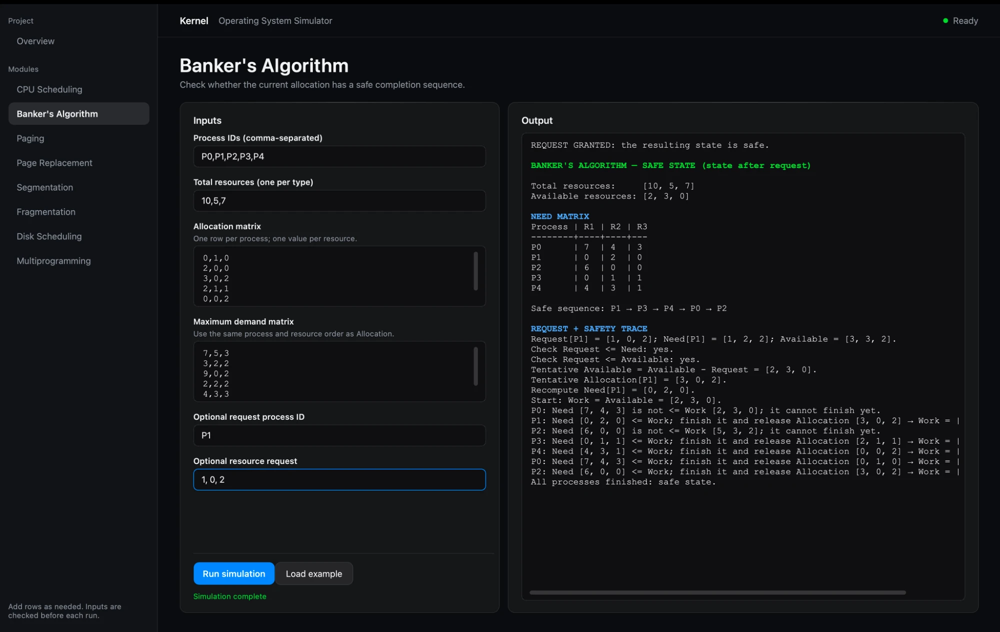

### 3. Paging
**Input:** logical and physical memory sizes, page size (bytes or `4KB`), page table (`page,frame` per line), logical address. **Process:** page = address // size, offset = address % size, physical = frame x size + offset; unmapped page = page fault. **Output:** the calculation step by step.
Sample: size 1024, table `0,5 / 1,2`, address 1030 → page 1, offset 6, frame 2, physical 2054.

### 4. Page Replacement
**Input:** reference string, number of frames, an algorithm, and a clock tick / window size (add `W` after a page, like `0W`, to mark a write). **Process:** on a fault with full frames the algorithm picks a victim: **FIFO** the oldest loaded page; **LRU** the least recently used; **Optimal** the page used farthest in the future; **Second Chance** is FIFO with a reference bit R: the oldest page is checked, R=1 means it gets another chance (R cleared, moved to the back) and R=0 means it is replaced; **Clock** makes the same decisions as Second Chance, but the frames that are candidates for replacement are treated as a circular buffer with a hand (▶); **NRU** (Not Recently Used) keeps R (referenced since the last clock tick) and M (modified) per page and puts each page in a class, class = 2R + M (0 = not referenced, not modified; 1 = not referenced, modified; 2 = referenced, not modified; 3 = referenced, modified); a random page from the lowest non-empty class is replaced; **NFU** keeps a counter per page, adds R to it at every clock tick, and replaces the lowest counter (oldest page on a tie); **Random** replaces a random frame; **Working Set**: the set of pages a process is currently using is its working set (pages used within the last N references, the window); on a page fault a page that is not in the working set is evicted (the first such page in frame order), or the oldest page if every page is in the working set. Random and NRU use a fixed seed, so a run always gives the same result. The clock tick clears the R bits for NRU and NFU every N references. **Output:** frame contents per step (with R / M / counter bits where the algorithm uses them), a Decision column for the bit-based algorithms, hit/fault per step, totals and fault rate.
Sample: `7,0,1,2,0,3,0,4,2,3,0,3,2,1,2,0,1,7,0,1`, 3 frames → FIFO 15, LRU 12, Optimal 9, Second Chance 11, Clock 11 faults.
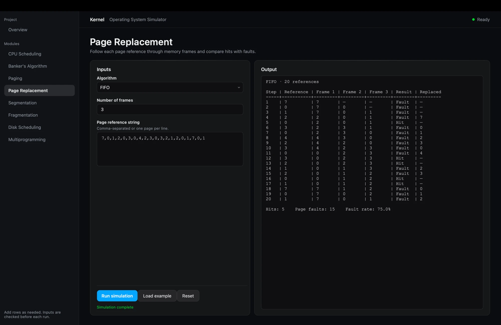

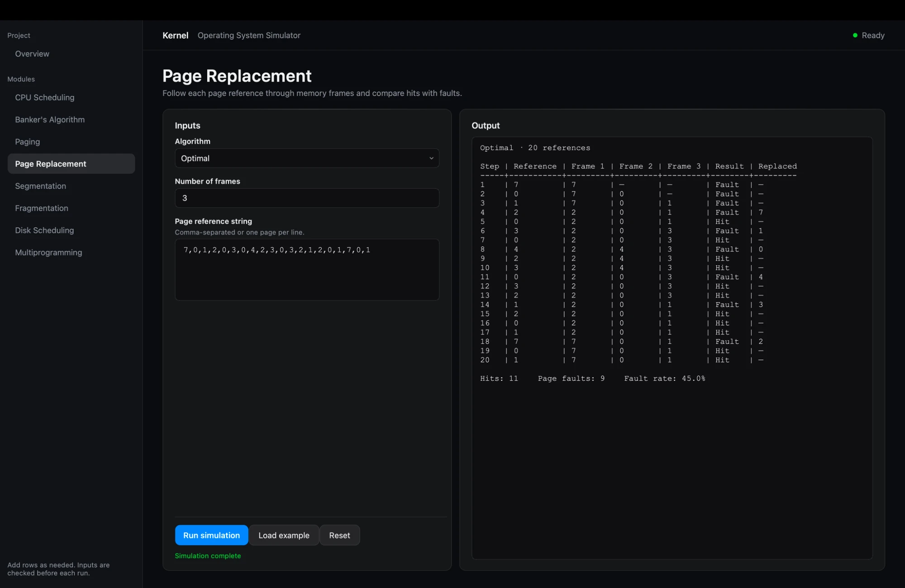

### 5. Segmentation
**Input:** RAM size, segment table (`segment,base,limit`), segment number and offset. **Process:** segments must fit in RAM without overlapping; the access is valid only if offset < limit; physical = base + offset. **Output:** the physical address and the physical memory map, or an error.
Sample: segment 1 (base 6300, limit 400), offset 99 → 6399; offset 400 → error.
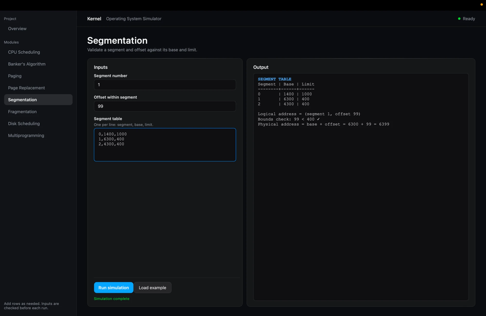

### 6. Fragmentation
**Input:** memory block sizes, processes (`ID,size`) and First/Best/Next/Worst fit. **Process:** each block holds one process; a process takes the empty block chosen by the strategy and is never put into an occupied block. First fit takes the first empty block that fits, Best fit the smallest, Worst fit the largest, Next fit continues after the last placement. Unused space inside a filled block is internal fragmentation; empty blocks left over while a process cannot be placed are external fragmentation. **Output:** allocation table, memory map (filled and empty blocks), unallocated processes, internal and external fragmentation, plus a colour-coded chart that draws First, Best, Next and Worst fit side by side on the same input (each block to scale, one colour per process, grey for empty blocks).
Sample: blocks `100,500,200,300,600`, processes `212,417,112,426` → First fit leaves P4 unallocated, Best fit places all four.
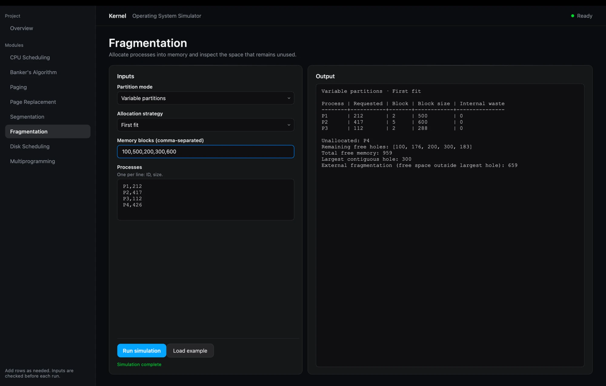
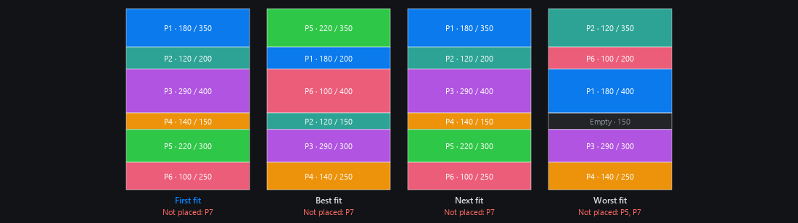

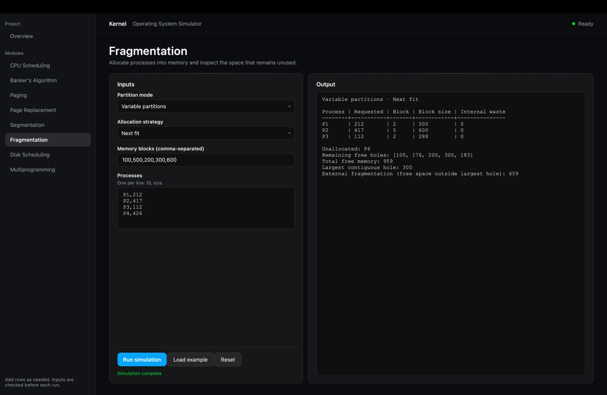

### 7. Disk Scheduling
**Input:** request list, head position, cylinder range, direction. **Process:** FCFS in arrival order; SSTF nearest next; SCAN (Elevator) sweeps to the disk end then reverses; C-SCAN sweeps then jumps to the other end; LOOK/C-LOOK turn at the last request. **Output:** service order, head path and total movement.
Sample: `98,183,37,122,14,124,65,67`, head 53, 0-199 → FCFS 640, SSTF 236, SCAN 331, C-SCAN 382, LOOK 299, C-LOOK 322.
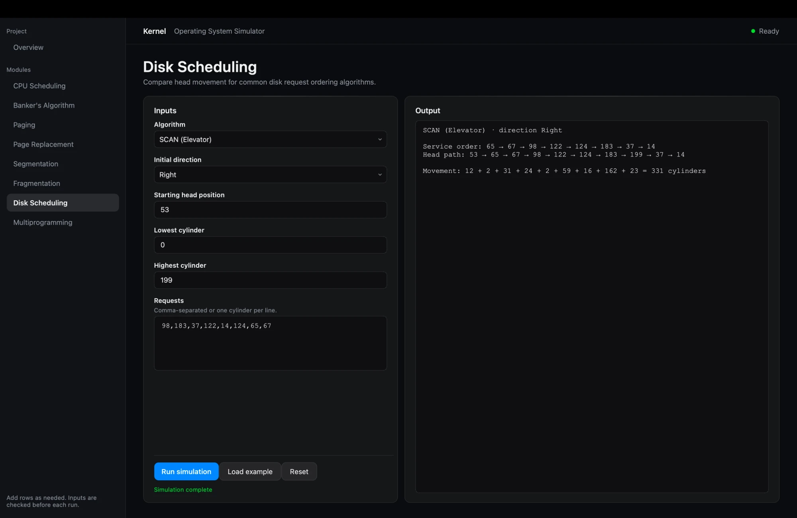

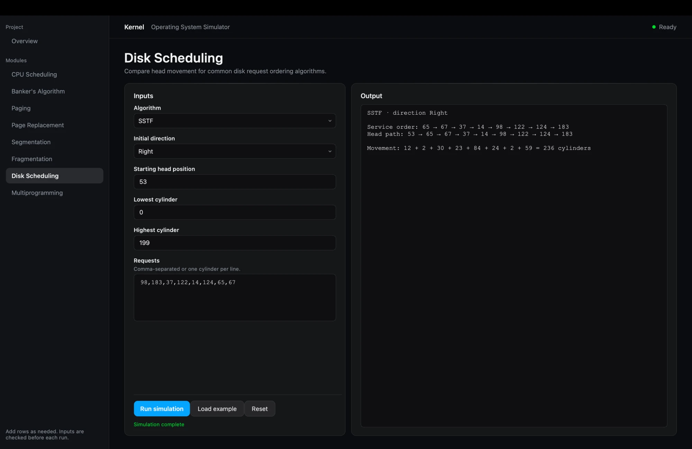

### 8. Multiprogramming
**Input:** jobs (`ID,arrival,burst`). **Process:** every active job receives an equal 1/n share of one CPU; the simulation advances from event to event (arrival or completion). **Output:** an event log with the active count, CPU share, hardware share, sharing jobs and each job's remaining work.
Sample: `A,0,4 / B,0,2` → B completes at 4, A at 6.
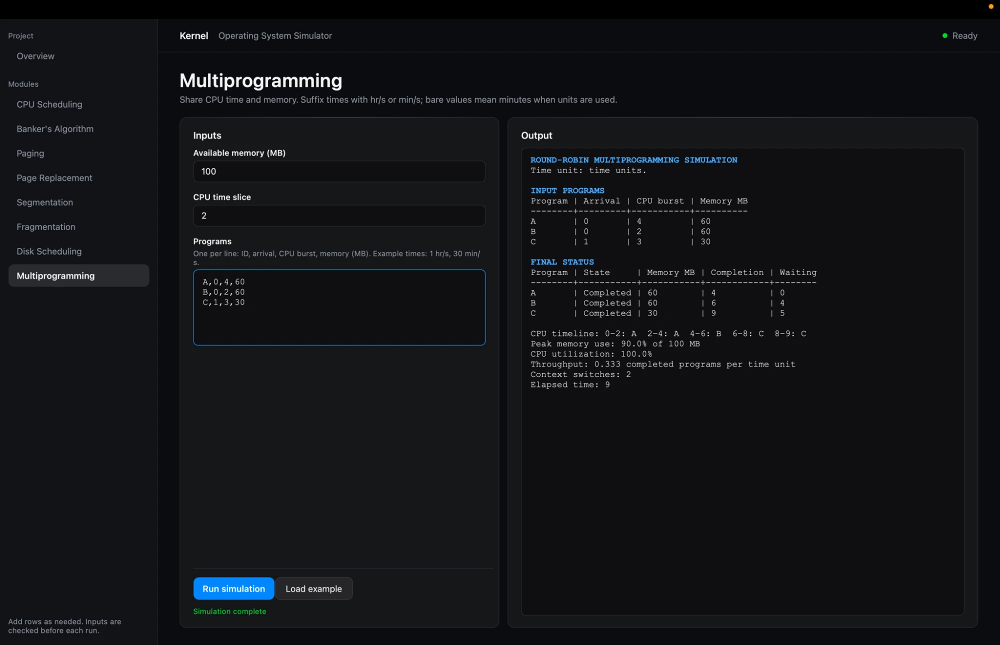

## Testing

`python tests/test_algorithms.py` runs 49 tests (166 checks) and prints each input, expected answer, actual answer and CORRECT / WRONG (`python -m unittest discover tests` gives a plain pass/fail run): known textbook answers, boundary and error cases, and one large dataset per module (hundreds to 20,000 items). Output is saved in `docs/test-results.txt`; every test is described in [`docs/unit-tests.md`](docs/unit-tests.md).

## Project team

- Amiel Amido — Group leader
- Kevin James Riparip — Project team
- Rafael Carlos III — Project team

## Project files

`kernel_app.py` starts the application. The `kernel_sim` folder contains the interface and the individual simulation modules. `run.bat` is a Windows launcher, and `.vscode/launch.json` provides a VS Code debug configuration.

## Notes

This is an educational simulator. It demonstrates simplified models and does not control the computer's actual CPU, memory, or disks.
